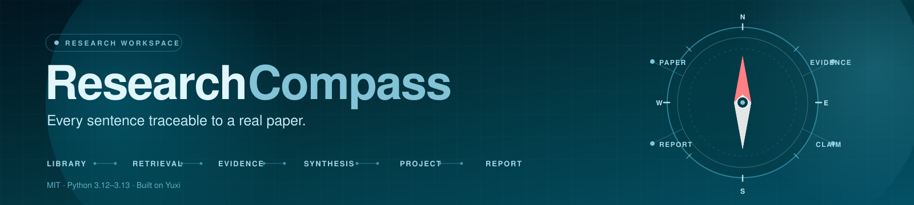

<div align="center">



<p>
  <a href="https://github.com/LPK3215/ResearchCompass/releases"></a>
  <a href="LICENSE"></a>
  <a href="docs/project/验证记录-2026-10-22.md"></a>
  <a href="https://www.python.org/"></a>
  <a href="https://vuejs.org/"></a>
  <a href="https://fastapi.tiangolo.com/"></a>
  <a href="docker-compose.yml"></a>
  <a href="https://lpk3215.github.io/ResearchCompass/"></a>
  <a href="https://github.com/LPK3215/ResearchCompass/stargazers"></a>
  <a href="https://github.com/LPK3215/ResearchCompass/forks"></a>
  <a href="https://github.com/LPK3215/ResearchCompass/issues"></a>
</p>

<h1>ResearchCompass 科研罗盘</h1>

<p><strong>ResearchCompass 是一个面向文献综述、证据管理与课题执行的证据可追溯科研工作台。</strong></p>

<p>它把论文变成可检索、可核查的私有文献库，再把检索、读论文、证据约束综述、研究项目与报告导出串成一条可追溯流水线。它在开源智能体框架 Yuxi 之上增加了学术章节分块、引用图谱、证据校验与可复现实验。</p>

<p><strong>仓库：</strong> <a href="https://github.com/LPK3215/ResearchCompass">LPK3215/ResearchCompass</a> · <strong>文档站：</strong> <a href="https://lpk3215.github.io/ResearchCompass/">lpk3215.github.io/ResearchCompass</a></p>

<p>
  <a href="#它能干什么">核心功能</a> ·
  <a href="#可视化">可视化</a> ·
  <a href="#30-分钟上手">快速开始</a> ·
  <a href="#技术栈">技术栈</a> ·
  <a href="#文档地图">文档</a> ·
  <a href="#faq">FAQ</a> ·
  <a href="https://lpk3215.github.io/ResearchCompass/">产品主页</a>
</p>

<p><a href="README.md">English</a></p>

</div>

## 可视化

顶部横幅由 [`scripts/visualization/generate_banner.mjs`](scripts/visualization/generate_banner.mjs) 生成；图内文字为英文，两版 README 共用同一文件。以下交互式图由仓库真实代码生成，浏览器打开后支持动态演示与深浅色切换；图内沿用上一轮的中文标签，横幅与 SVG 资产为英文。

- [项目全景观览页](https://lpk3215.github.io/ResearchCompass/project_overview/) — 一页看完架构、证据链路、评测、API 与质量门禁。

| 视图 | 链接 |
| --- | --- |
| 核心架构 | [core-architecture.html](./docs/archify/core-architecture.html) |
| 全景架构 | [architecture-panorama.html](./docs/archify/architecture-panorama.html) |
| 核心工作流 | [workflow-panorama.html](./docs/archify/workflow-panorama.html) |
| 请求时序 | [sequence-panorama.html](./docs/archify/sequence-panorama.html) |
| 数据流 | [dataflow-panorama.html](./docs/archify/dataflow-panorama.html) |

## 它能干什么

| 我想要…… | 实际得到的是 | 入口 |
| --- | --- | --- |
| 建一个私有文献库 | 按 Abstract / Method / Experiments 等学术章节切分、带页码与字符区间的论文知识库 | 知识与工具管理 → 知识库 |
| 找到可追溯的证据 | 论文 + 章节 + 原文片段 + 四路检索分数，点开回到 PDF 原文位置 | 科研罗盘 → 智能检索 |
| 写一份证据约束综述 | 主题综述、核心结论、证据矛盾、研究局限、研究空白，外加「未支持结论」清单 | 科研罗盘 → 证据综述 |
| 读懂单篇论文 | 单 Agent 结构化提取，或四阶段多 Agent 拆解（创新点 / 方法学 / 空白） | 论文库 → 论文分析 |
| 管理一个真实课题 | 里程碑、任务、成果归集、风险登记、确定性进度与可导出报告 | 科研罗盘 → 研究项目 |
| 看清研究地图 | 引用图谱（含两跳关系）、发表趋势、带判断依据的机会分 | 科研罗盘 → 引用图谱 / 趋势 / 机会 |
| 用 AI 研究助手推进工作 | 带知识库、项目与当前选中对象上下文，调用领域工具，敏感操作先审批的对话式执行 | 科研罗盘右侧面板 / 科研助手页 |
| 自证效果 | RAG 评估、检索消融、单/多 Agent 盲评、SUS 匿名用户评测 | 知识库详情 / 科研罗盘 → 分析对比、用户评测 |

底层通用能力来自开源智能体框架 Yuxi：多租户知识库、LangGraph 智能体运行态、沙盒、中间件、MCP/Skills/SubAgents 与模型供应商配置。ResearchCompass 在其上实现学术章节分块、论文引用图谱、证据约束综述、项目执行中心与可复现实验。

## 一条完整链路

```text
建库 → 传 PDF → 读论文 → 检索找证据 → 综述（校验 → 生成 → 导出）
        ↓                                      ↓
   研究趋势 / 研究机会                    研究项目（里程碑 / 任务 / 成果）
                                               ↓
                                      导出报告 → 论文各章节
                                               ↓
                                 评测 / 消融 / 盲评 / 用户评测
```

- [从选题到成稿](docs/intro/research-workflow.md)：每一步点哪里、产出什么、怎么判断做对了。
- [能力全景](docs/intro/capabilities.md)：快速了解系统能做什么。

## 30 分钟上手

1. 建一个 Milvus 知识库，上传 5～10 篇你熟悉的论文，分块策略选 **Academic Paper**。
2. 在「智能检索」里问一个你已知答案的问题，核对返回的证据是否对得上原文。
3. 用「证据综述」生成一份小综述；失败于证据校验时点「一键录入并验证」再「重新生成」。
4. 建一个研究项目，把检索与综述归集进去，导出 Markdown 报告。

## 项目结构

```text
ResearchCompass/
├── backend/                  FastAPI API、LangGraph 智能体、科研服务与测试
│   ├── server/               HTTP 入口与路由
│   ├── package/yuxi/         智能体运行时、知识库、存储与科研服务
│   ├── scripts/              冒烟验收、语料导入与维护脚本
│   └── test/                 单元 / 集成 / 端到端测试
├── web/                      Vue 3 + Vite 前端
├── docs/                     VitePress 文档、Pages 入口与交互式概览
│   ├── index.html            GitHub Pages 入口（跳转到 project_overview/）
│   ├── .nojekyll             禁用 Jekyll，适配经典 Pages
│   ├── assets/               品牌资产（banner.svg）
│   ├── archify/              交互式架构、工作流、时序与数据流 HTML
│   └── project_overview/     静态项目全景观览页
├── docker/                   Dockerfile、nginx 与沙盒 provisioner
├── scripts/                  初始化、发布、冒烟与评测脚本
│   └── visualization/        可视化资产生成脚本（横幅）
├── docker-compose.yml        开发环境编排
├── docker-compose.prod.yml   生产环境编排
├── ARCHITECTURE.md           代码地图与架构不变量
├── CONTRIBUTING.md           贡献入口
├── FAQ.md                    常见问题与处理
└── SECURITY.md               安全策略
```

## 技术栈

| 层级 | 技术 |
| --- | --- |
| 前端 | Vue 3 · Vite · Pinia · ECharts · G6 · PDF.js |
| 后端 | FastAPI · LangGraph · ARQ |
| 检索与图谱 | Milvus · BM25 · Cross-Encoder · Neo4j |
| 存储 | PostgreSQL · Redis · MinIO |
| 文档解析 | MinerU · PaddleX · RapidOCR |
| 部署 | Docker Compose |
| 文档与可视化 | VitePress · SVG · Archify HTML |

**运行要求：** Python 3.12–3.13（见 `backend/pyproject.toml`）、Node.js 与 pnpm 10.11.0（见 `web/package.json`）；完整栈使用 Docker Compose。

## 文档地图

| 我想了解 | 看这份文档 |
| --- | --- |
| 这套系统到底能干什么 | [能力全景](docs/intro/capabilities.md) |
| 怎么从选题做到成稿 | [从选题到成稿](docs/intro/research-workflow.md) |
| 功能规则细节（项目 / 检索 / 综述 / 评测） | [科研罗盘 ResearchCompass](docs/intro/research-compass.md) |
| 装起来、跑起来 | [快速开始](docs/intro/quick-start.md) · [生产部署](docs/advanced/deployment.md) |
| 本地开发、worker 与排障 | [本地开发环境](docs/develop-guides/local-dev-environment.md) · [FAQ](FAQ.md) |
| 模型与 API Key 怎么配 | [模型配置](docs/intro/model-config.md) · [API Key 外部集成](docs/advanced/api-key-integration.md) |
| 知识库、图谱与评估底层 | [知识库与知识图谱](docs/intro/knowledge-base.md) · [知识库评估](docs/intro/evaluation.md) |
| 智能体 / 工具 / MCP / Skills | [智能体开发](docs/agents/agents-config.md) |
| 改了什么、为什么这么改 | [版本变更记录](docs/develop-guides/changelog.md) · [规划与决策](docs/project/规划与决策.md) |
| 代码边界与运行链路 | [ARCHITECTURE.md](ARCHITECTURE.md) |
| 怎么参与贡献 | [CONTRIBUTING.md](CONTRIBUTING.md) · [贡献指南](docs/develop-guides/contributing.md) |
| 怎么报告安全问题 | [SECURITY.md](SECURITY.md) |

> 立项方案、决策记录、实现跟踪表与验收记录统一归档在 [`docs/project/`](docs/project/README.md)，不随文档站发布。

## 安装与运行

### 环境要求

- Docker Engine 与 Docker Compose。
- 至少一个兼容 OpenAI 接口的对话模型和一个向量模型；完整栈也提供本地 `local-embedding` 供应商。
- 只有在 Docker 外运行后端或前端时，才需要 Python 3.12–3.13 与 pnpm 10.11.0。

### 开发环境

```bash
git clone --branch v0.11.15 --depth 1 https://github.com/LPK3215/ResearchCompass.git
cd ResearchCompass

# Linux / macOS
./scripts/init.sh

# Windows PowerShell
.\scripts\init.ps1

docker compose up -d --build
```

- Web：<http://localhost:5173>
- API 健康检查：<http://localhost:5051/api/system/health>
- API 文档：<http://localhost:5051/docs>

完整模式默认启动 PostgreSQL、Redis、MinIO、Milvus、Neo4j、API、worker 与 Web。MinerU 与 PaddleX 属于 `all` profile，可按需启动。

### Lite 模式

如果不需要知识库、图谱与科研依赖：

```bash
make up-lite
```

Lite 模式只启动核心服务，默认入口为 `/agent`，并隐藏 ResearchCompass、知识库与图谱入口。运行 `make up` 可切回完整模式。

### 生产部署

```bash
cp .env.prod.template .env.prod
# 填写所有 REQUIRED 项与实际模型密钥
docker compose -f docker-compose.prod.yml config --quiet
docker compose -f docker-compose.prod.yml up -d --build
```

不要提交 `.env`、`.env.prod`、测试账号、论文私有数据或任何 API 密钥。详细要求见 [生产部署指南](docs/advanced/deployment.md)。

### 验证

Windows 下执行完整冷构建检查：

```powershell
.\scripts\release_check.ps1
```

本地检查：

```bash
make lint
make test
make test-web
make docs-build
```

`release_check.ps1` 会冷构建开发与生产镜像（含完整 / Lite 两种前端）、检查两级 Python 锁文件与全仓 Ruff 规则、运行后端单元 / 集成 / E2E 测试，并完成前端单测、ESLint、生产构建与 VitePress 文档构建。

验收记录：

- **2026-10-22 浏览器验收：** 22 项；17 项通过（其中 2 项修复后通过），2 项受凭据约束未验证，2 项为避免写入 / 模型调用未执行，1 项数据清理待授权。见 [验证记录-2026-10-22](docs/project/验证记录-2026-10-22.md)。
- **2026-10-20 浏览器验收：** A–I 九组共 90 项，未解决项 0。见 [验证记录-2026-10-20](docs/project/验证记录-2026-10-20.md)。
- **2026-10-21 能力缺口总账：** 44 条 —— 39 条已完成、0 条待修复、4 条待评估、1 条不做。见 [能力缺口与双通道收口报告](docs/project/2026-10-21-capability-gaps-and-dual-channel-plan.md)。

最新一轮验收中存在明确列为未验证、未执行或待授权的条目，项目不宣称 100% 全部通过。

## FAQ

- **综述为什么提示“只能引用已验证证据”？** 在证据面板中录入并验证检索片段，再重新生成；系统不会把未验证文本伪装成结论。
- **严格图谱检索为什么失败？** 先同步引用图谱；严格模式不会静默降级。
- **为什么清单是 0.11.0，最新标签是 v0.11.15？** 清单是包元数据，标签是发布版本；详见 [CHANGELOG.md](CHANGELOG.md)。

更多问题与处理见 [FAQ.md](FAQ.md)。

## 参与贡献

快速流程见 [CONTRIBUTING.md](CONTRIBUTING.md)，完整规范以 [docs/develop-guides/contributing.md](docs/develop-guides/contributing.md) 为唯一真源。提交 PR 前至少执行：

```bash
make format
make lint
make test
```

提交信息使用清晰的 Conventional Commit 风格，并填写 [PR 模板](.github/PULL_REQUEST_TEMPLATE.md)。UI 改动请附截图或录屏；较大功能请先开 Issue 讨论设计与边界。

## 安全

请通过 [SECURITY.md](SECURITY.md) 或 GitHub Security Advisories 私下报告安全问题，不要公开提交安全 Issue。AI 研究助手不执行系统命令、不直接写任意文件；研究交付物通过导出工具生成。需要沙盒执行的智能体使用独立沙盒服务。

## 许可证与致谢

本项目采用 [MIT License](LICENSE)。它构建在开源智能体框架 [Yuxi](https://github.com/xerrors/Yuxi) 之上：通用智能体运行态、多租户知识库、沙盒与中间件来自 Yuxi；本仓库的科研业务流程、领域工具、证据综述与实验能力由 ResearchCompass 作者设计与实现。

项目同时参考并使用了以下优秀开源项目：

- [LightRAG](https://github.com/HKUDS/LightRAG) —— 图谱构建与检索思路。
- [DeepAgents](https://github.com/langchain-ai/deepagents) —— 深度智能体框架。
- [DeerFlow](https://github.com/bytedance/deer-flow) —— 沙盒智能体架构思路。
- [RAGFlow](https://github.com/infiniflow/ragflow) —— 文档分块策略。
- [LangGraph](https://github.com/langchain-ai/langgraph) —— 多智能体编排。
- [QwenPaw](https://github.com/agentscope-ai/QwenPaw) —— 模型配置与个人文件区设计。

各依赖的权利归原作者所有。维护者与上游归属见 [AUTHORS](AUTHORS)。

## 维护者

ResearchCompass 由 [LPK3215](https://github.com/LPK3215) 设计与维护 · <17538703215@163.com>。

## 版本说明

Python 与 Web 包清单版本为 `0.11.0`；最新发布标签为 `v0.11.15`。权威且详细的版本历史见 [docs/develop-guides/changelog.md](docs/develop-guides/changelog.md)。需要可复现检出时使用发布标签；查看包元数据时以清单为准。
